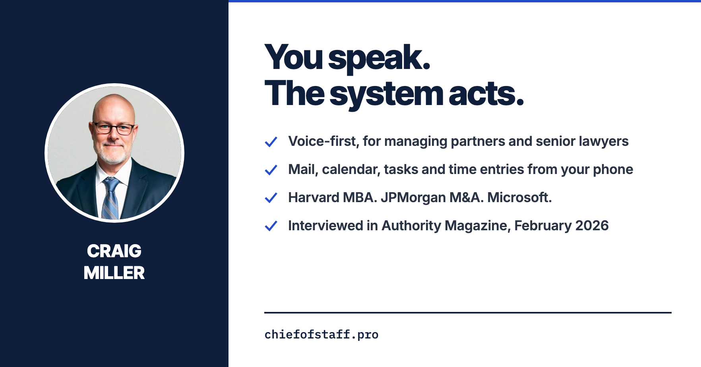

  

<picture>
  <source media="(prefers-color-scheme: dark)" srcset="https://raw.githubusercontent.com/ChiefofStaff-pro/.github/main/profile/assets/stats-dark.svg">
  
</picture>

 

<table>
<tr>
<td width="220" valign="top">

</td>
<td valign="top">

**Craig Miller**, founder of ChiefofStaff.pro and Sonnet Advisors, based in Zürich. Grew up in eight countries.

M&A banker at JPMorgan in San Francisco, then Microsoft across Switzerland and Western Europe, then CFO and CCO seats. Harvard MBA, McGill engineering. Not a practising solicitor.

Now building **ChiefofStaff**: a voice-first system for partners at small firms who no longer have a big firm's support staff behind them.

</td>
</tr>
</table>

---

## Start here

**01. Zero Inbox Day** `Free · Thursday 19 November 2026`  
One working day with your Microsoft 365 mail and calendar run by voice from your phone. A setup call beforehand and 14 days free afterwards. Applications close Friday 13 November, or when the eight seats are taken. **[Apply for a seat →](https://handsfree.pro)**

**02. Fee Leakage Audit** `£7,950 fixed`  
Every leak between the work and the bank, measured from your practice management data: realisation by matter and partner, write-offs and who approved them, lock-up, unrecorded time and scope. You get a written report for the partnership, priced at your own rates and ranked. **[Book the audit →](https://chiefofstaff.pro/fee-leakage-audit)**

**03. ChiefofStaff** `£995 setup + £99 per person a month`  
The hosted system. You speak from your phone, it acts in your mailbox and calendar, and it logs your tasks and time. Guided setup for you and up to four colleagues through **[Faststart →](https://chiefofstaff.pro/faststart)**, open to graduates of the free Buy Back Your Time course, with the £395 diagnostic fee credited.

**04. Buy Back Diagnostic** `£395 · 90 minutes`  
A paid session with me on where your time goes and what to hand over. Includes a written report and a money-back guarantee. **[Book it →](https://chiefofstaff.pro/buyback-diagnostic)**

---

## Free skills, coming soon

Written for Claude Code and run on your own machine. Follow this organisation to see each one when it ships.

**Call Write-Up** `Free · coming soon`  
A call transcript goes in. Minutes, action items and a follow-up email come out.

**Time Draft** `Free · coming soon`  
Your calendar, inbox, sent mail and call notes become provisional time entries before you sit down to do them. Any day, week or date range, broken down by day, by email, CSV or another format you choose. It drafts and never submits.

**Onboarding Pack** `Free · coming soon`  
Call notes and your own templates become an engagement letter draft, a covering email and a checklist. Conflict and AML steps open for a named person to complete.

**How We Do It Here** `Free · coming soon`  
An SOP interview. It asks you a series of questions about how a task really gets done, then writes the procedure with owners, steps and templates.

**LinkedIn Demand Board** `Free · coming soon`  
Your own LinkedIn exports become a private dashboard that says what to do more of and what to stop.

**Starter Brain** `Free · coming soon`  
A second brain that interviews you at intervals, over several sessions, until the files about you, your firm and your goals are filled in.

### Have it set up for you

**Set up for you** `£450 fixed · one hour`  
Once Call Write-Up ships, I install it with you and leave it working on your own calls.

**Founder option** `£750 total`  
The one-hour setup, plus product quotes, product-market-fit evidence and recurring challenges pulled together across your calls.

**[Ask me about either on LinkedIn →](https://linkedin.com/in/ccmiller)**

---

## Free resources

| | |
|:--|:--|
| [The Business Side Of Law: Craig Miller of ChiefofStaff.pro](https://medium.com/authority-magazine/the-business-side-of-law-craig-miller-on-5-things-you-need-to-create-or-lead-a-9aaf13d8ad76) | Authority Magazine interview by Eric L. Pines, Feb 2026 |
| [The Verification Inversion](https://chiefofstaff.pro/verification-inversion) | Paper, Sep 2026 |
| [The Maister Paper](https://chiefofstaff.pro/maister-paper) | Paper, Oct 2026 |
| [Fee Leakage Diagnostic](https://chiefofstaff.pro/fee-leakage-diagnostic) | 13 questions, personalised PDF report |
| [Buy Back Your Time](https://chiefofstaff.pro/buy-back-time) | Free 7-email course |

→ **[Subscribe to LevelUP Strategies on LinkedIn](https://www.linkedin.com/build-relation/newsletter-follow?entityUrn=7239605634936061953)** · **[Essays on Substack](https://chiefofstaffpro.substack.com)** · **[All writing at chiefofstaff.pro](https://chiefofstaff.pro/blog)**

---

## What ChiefofStaff does not do

`Conflict checks` &nbsp; `AML or KYC` &nbsp; `Legal advice` &nbsp; `Reading inside documents` &nbsp; `Google mail, yet`

---

## Stack

---

Thanks to [Iwo Szapar](https://github.com/iwo-szapar), who started me off with the second brain.
